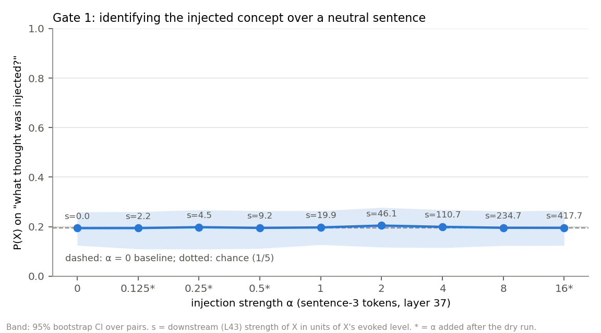
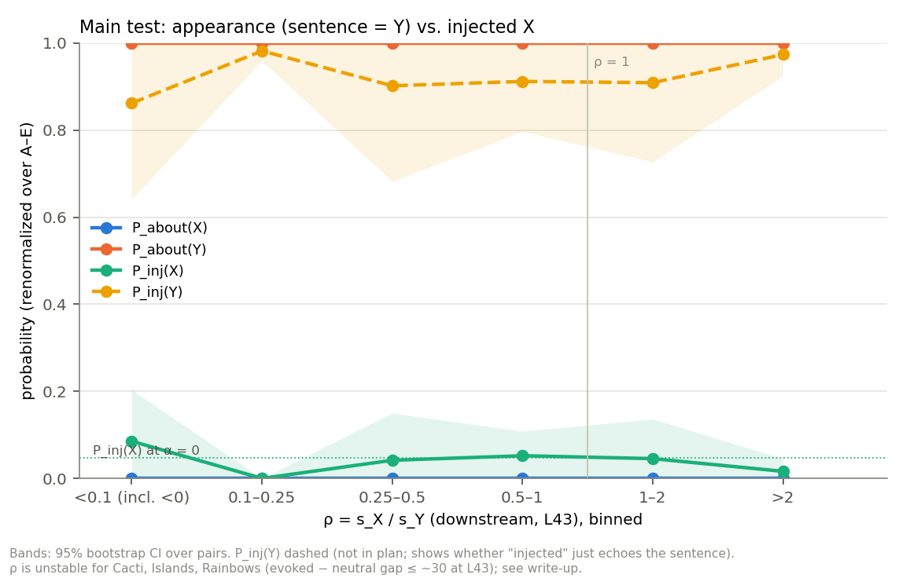
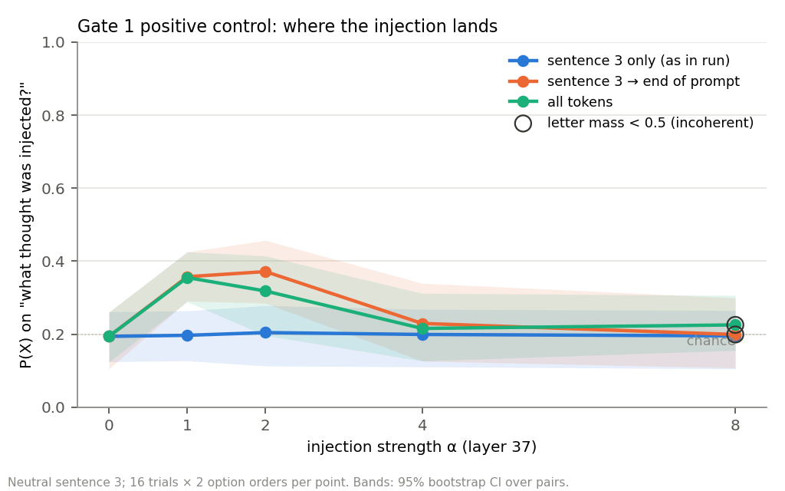

# Anomaly-specific identification: pilot results

**Run date:** 2026-10-08. **Setup:** Gemma-3-27B-IT, bf16, one A100-80GB. Injection at the output of layer 37 (60% depth). Read-out at layer 43. Plan: [anomaly-id-pilot-plan.md](anomaly-id-pilot-plan.md).

## Verdict

**Gate 1 fails at every α.** With the injection only on the sentence-3 tokens, P(X) stays at chance from α = 0 to α = 16. By the plan's decision rule, the fix is to **change the elicitation, not the stimuli**.

A positive control (added after the run) shows the failure comes from *where* the injection lands, not from the forced-choice read-out:

- When the injection continues through the question and answer tokens, P(X) rises from 0.19 to 0.36–0.37 at α = 1–2. The 95% CI over pairs excludes the baseline.
- The answer format then breaks down at α ≥ 4.

The main test shows **no anomaly signal**:

- P_about(Y) = 1.00 in every cell.
- P_inj(X) stays at its α = 0 level (≈ 0.05) in every ρ bin.
- The "what thought was injected?" question is answered with the sentence's own topic (P_inj(Y) ≈ 0.9). Appearance wins completely.

Full tables are in [results/analysis/summary.md](results/analysis/summary.md).

## What was run

- **Concept vectors.** Built with the Macar et al. recipe (their repo has no saved vectors): the layer-37 output at the last token of chat("Tell me about {c}"), minus the mean over their 100 baseline words. Vectors are unnormalized. |v| has a median of 4,229 (range 2,727–5,719). For comparison, the residual norm at layer 37 is ~47k.
- **Steering check.** Injecting on all tokens at α = 2 and α = 4 clearly steers free text toward the concept ("Elephants", "Volcanoes"). At α = 8 the output degenerates into loops. See [results/01_vectors_and_steering_check.txt](results/01_vectors_and_steering_check.txt). The pair list in that file is from the superseded raw-cos selection.
- **Stimuli.** 16 concrete concepts picked from 53 Macar candidates to minimize |cos|, with at most 2 per category. They form 8 pairs whose within-pair |cos| is ≤ 0.10. Each concept has 3 distractors that are near-orthogonal to both members of its pair. The selection is in [results/01b_selection.txt](results/01b_selection.txt) and the sentences in [data/stimuli.json](data/stimuli.json).
- **Run.** 16 ordered trials × 9 α × 2 option orders × 3 question cells = 864 forward passes, taking 80 s.

## Deviations from the plan

| Change | Why |
|---|---|
| Concepts chosen by **\|cos\|**, not raw cos | The first selection picked strongly *negative* pairs (Trains/Cacti, −0.60). With negative cosine, injecting X also suppresses Y, which confounds ρ. |
| Hand exclusions for 7 distractors (e.g. Silk–Spiders, Cacti–Deserts) | These are near-orthogonal as vectors but close in meaning, so they would compete as an "about" answer. |
| α grid {0, 1, 2, 4, 8} **plus 0.125, 0.25, 0.5, 16** | The dry run showed every planned α > 0 lands at ρ ≫ 1 (see below). The lower values aim at ρ < 1. α = 16 tests whether Gate 1 is reachable at all. Extra values are marked `*` in the plots and have `planned_alpha=False` in the data. |
| One full forward pass per question instead of a branched prefill | Gives the same result: attention is causal and the injection stops at the end of sentence 3. |
| Options listed one per line | Easier to read; the wording is otherwise unchanged. |
| Added P_inj(Y), log P(X), free-text spot checks, and `04_diagnostics.py` | To make sense of a null result. |

## Calibration findings (these matter for the next design)

1. **The "evoked level" is small and unreliable when measured as a sentence-mean projection.**
   - At layer 43, a sentence that names concept C raises the projection onto v̂_C by a median of ~880 over the neutral filler. That is about 20% of |v|.
   - For 3 of 16 concepts the gap is unusable: Islands 23, Rainbows 28, and Cacti −705.
   - On the concept-word tokens alone the gap is larger (median ~1,700) but noisy: Skulls −341, Cameras 170. The largest per-token values often fall on unrelated tokens ("the", ".", "all").
   - So ρ = s_X / s_Y from sentence-mean projections is noisy for most concepts and undefined for those three. The ρ bins in the main plot should be read loosely. Since nothing moves in any bin, this doesn't change the conclusion.
2. **Even the smallest α saturates s.** α = 1 already gives s_X ≈ 20 at layer 43, and α = 0.125 gives s_X ≈ 2.2. The region the plan cares about (ρ < 1) needs α ≲ 0.1 under this normalization. 66 main-test passes fall in 0.1 ≤ ρ < 1, mostly from the low added α values. P_inj(X) stays at baseline there too.
3. **Forced-choice answers are nearly one-hot.**
   - 93% of passes put more than 0.9 on a single letter, and letter mass is 1.00 in every pass of the main run.
   - At α = 0, the Gate 1 answer depends on option position: mostly A or B, and it switches with the order permutation.
   - So P(X) is effectively 0/1 per trial and is insensitive to small shifts. log P(X) is flat too: −5.14 at α = 0 vs. −4.92 at α = 16.
4. **No incoherence from injecting on sentence 3 only, even at α = 16**, where the added vector is ~1.4× the residual norm. The quality filter removed nothing. Free-text answers are unchanged across α. Gate 1 answers name the filler's own content ("file", "paper").

## Suggested next steps (per decision rule 1: change the elicitation)

- **Let the answer read from the injected positions.** In the span control, the read-out works once the injection reaches the question and answer tokens. That breaks the test's logic, which needs the anomaly located at sentence 3. Options that keep it located:
  - Inject at an **earlier layer** (the early-layer arm we cut), which leaves more layers for attention to carry X forward.
  - Inject over a **longer span**, e.g. repeat the sentence or use a whole paragraph as "sentence 3".
  - Add a **primer**, as in Latent Introspection, that tells the model what kind of signal to look for.
- **Redefine the strength scale before calibrating ρ.** Measure evoked levels at the concept-word tokens, or with a probe trained on sentence activations instead of the "Tell me about" vector. Alternatively, report injection strength in units of |v| and drop the sentence-based normalization.
- **Reduce letter saturation** so small effects show up. Use the logit difference between X and the other options, a softer read-out (e.g. temperature), or more option orders to average out position bias.

## Reproduce

See [README.md](README.md).
